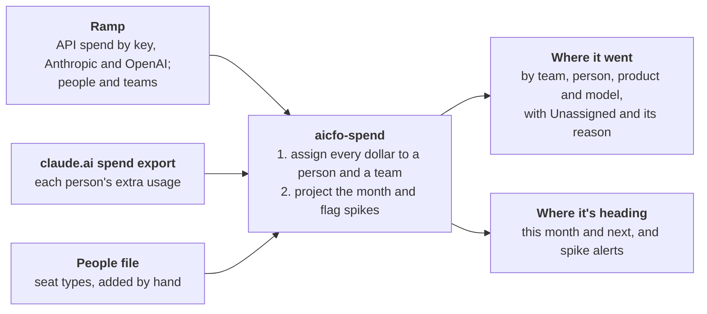

# aicfo-spend-analysis — design

**Status:** approved 2026-10-27; v0.3.1 released. v0.3.0 was the first as a Claude plugin. The v0.3.0 scripts it replaces live in `legacy/` until the cut-over checks a real month against them.

`aicfo-spend-analysis` is a small open-source tool, built on Ramp, that tells a company where its AI money went and where spending is heading. It reads the AI spend Ramp already collects through the Admin keys plugged into Ramp, so Ramp holds the keys and the tool never does. It runs without Claude. The `ai-spend-analysis` Claude skill ships beside it in this repo, which installs as one plugin; the skill is a thin layer that fetches the data, runs the tool and shows the results.

## What it does

The whole tool, in five sentences:

1. Each month it answers two questions about a company's AI spend: where did it go, and where is it heading?
2. It reads data the company already has: API spend for Anthropic and OpenAI and the people list from Ramp, plus each person's extra usage from the claude.ai spend export.
3. Every dollar goes to a person and a team; anything it can't place shows as Unassigned with the reason, so every dollar is accounted for.
4. It projects where this month will land and what next month will cost, and flags any day that spikes.
5. Claude fetches the data and shows the results; the math is an open-source Python tool anyone can run on their own files, and each new vendor is a small add-on.



Claude gathers the inputs and presents the answers; the open-source tool does the two steps in the middle.

**What a month looks like** (made-up numbers):

| Team | Seats | Extra usage | API | Total |
| --- | --- | --- | --- | --- |
| Engineering | $600 | $820 | $410 | $1,830 |
| Sales | $300 | $95 | $0 | $395 |
| Unassigned | $0 | $40 | $25 | $65 |
| **Total** | **$900** | **$955** | **$435** | **$2,290** |

- **Unassigned:** $40 of extra usage from someone with no team on the people list, and $25 from an API key with no team.
- **Forecast:** this month is on pace for $2,400, 5% above last month.
- **Alerts:** one spike, Engineering's API spend on the 14th at three times a normal day, drafted for someone to send.

Claude shows this as a dashboard page in tabs, with the seats roster as its last tab; the tool itself writes the same numbers to plain files.

**Words used here**

- **Seat:** the flat monthly fee for one person's plan, such as Claude Team or ChatGPT Business.
- **Extra usage:** what a person spends beyond what their seat includes.
- **API spend:** pay-per-use charges when software calls a model with an API key.
- **Admin key:** an organization-level key that can read the usage bill. It can also manage the account, so Ramp keeps it, not the tool.
- **Team:** a group of people for reporting; Ramp calls it a department.

## Done when

v1 is done when these three things are true. The first two are commands that print a result; the third is checked on the pull request.

1. **September matches the dashboard.** `aicfo-spend report 2026-09` gives the same seats, extra usage and API totals for airCFO, the first install, as the v0.3.0 dashboard, within $1 a line, after those numbers have been reviewed by hand.
2. **The forecast is scored.** `aicfo-spend forecast --as-of 2026-08-31 --score 2026-09` prints how far the forecast was from September's actual total, in dollars and percent. No target is set, because one month of history is too thin to set one.
3. **A second vendor fits.** OpenAI's API spend and real ChatGPT seats show up beside Anthropic's, and the pull request that adds them changes only OpenAI's folder.

**Not in v1:** companies not on Ramp (described under Inputs, built later), a FOCUS export, budgets, department-head sign-off, an accounting-system tie-out, splitting a shared key, currencies other than USD, a web UI, and sending anything (alerts and summaries are drafts).

## Inputs

Three inputs, matching the picture above. Claude fetches the first one through the Ramp connector.

| Input | What it gives | How it arrives |
| --- | --- | --- |
| Ramp | API spend for Anthropic and OpenAI by key, month to date, with each key's owner and department, from the Admin keys plugged into Ramp; each vendor's total for the same days, which also counts spend no current key carries; the people list (name, email, team, active); spend by vendor, for other AI vendors | Claude, through the Ramp connector |
| claude.ai spend export | Each person's extra usage, and their use of each product and model: requests and tokens, $0 of extra usage included | The existing browser script, or the export button. It covers only the last 90 days, so it's saved at least monthly |
| People file | Seat type for each person who holds a seat, plus anyone not in Ramp | Written by Claude from the dashboard's Seats tab, or kept by hand |

Settings (seat prices, seats bought, who sees person detail, alert thresholds, known changes) live in one small JSON file, `aicfo-spend.json`. It's JSON because Python 3.10 can't read TOML without an add-on package.

**Ramp holds the Admin keys, and the tool never touches one.** The tool doesn't call Claude or Ramp either: it reads files in a folder, which Claude fills through the Ramp connector or a person fills with exports from Ramp.

**Without Ramp** (described here, built later): the tool would read the Anthropic and OpenAI Admin APIs directly, with an Admin key kept on the company's own machine, and a short keys file would name each key's owner. The v0.3.0 Anthropic fetcher in `legacy/` is a starting point.

**Downloads are saved once and never edited.** Claude hands each download to `aicfo-spend save`, which checks it, files it in the folder for the month it covers as `<source>_<start>_<end>_saved-<time>`, and makes it read-only. Ramp's per-key spend, Ramp's vendor totals (saved beside the per-key spend, for the same days) and the claude.ai export are saved month to date, starting on the 1st, and each run re-pulls the month so far because vendors revise recent days. The download reaching furthest into the month counts; the older ones stay for the record, and if a newer one shows less than an older one, the report says so. A rerun rebuilds every number from these files, so any number traces back to one. A month uses the first Ramp people list saved after it ended, so re-running a past month gives the same teams. A claude.ai export is named for the days it covers, so `save` refuses one whose name says other days than it's given, and `--remove-original` deletes the downloaded copy once it's saved, keeping company data out of Downloads.

**One plain table.** Every input becomes rows of `spend.csv`: start date, end date, vendor, product (seats, extra usage or API), person, team, reason (for Unassigned rows), API key, model, amount in USD and source file. Each row covers the dates of the download it came from. For API rows, the person is the key's owner, and the model is blank because Ramp reports spend per key, not per model. `aicfo-spend report <folder> <month>` writes the table and prints totals by team. Each company's files live in one folder, outside any git repo:

```text
<workspace>/
  aicfo-spend.json   settings: seat prices, seats bought, visibility, alert thresholds
  people.csv         seat type, plus anyone not in Ramp
  raw/<YYYY-MM>/     every download, saved once, never edited
  out/<YYYY-MM>/     spend.csv, plan.json, alerts.txt, dashboard.json
```

## Who spent it

Two lookups place almost every dollar, and whatever they can't place shows as Unassigned with its reason.

1. **Person → team.** Seats and extra usage carry a person's email, and the Ramp people list gives their team. A seat costs the price for its type, from settings.
2. **API key → team.** A key's team is its Ramp department tag, or else its owner's team.

**Unassigned has four reasons**, each on its own line:

- **No team on the people list:** someone in the spend export the people list doesn't place on a team, either because they're in neither Ramp nor the people file or because they're listed with no team.
- **Key with no team:** no department tag and no owner. The fix is made in Ramp, where the key lives.
- **Empty seat:** settings say how many seats were bought, and fewer people hold one. It's the signal to reclaim them.
- **API spend not tied to a current key:** Ramp's total for a vendor is more than its keys add up to. The usual cause is a key deleted or rotated during the month, because Ramp lists only the keys the vendor's console still has. If a vendor's keys instead add up to more than Ramp's total by over $1, the report says so, since that points to a copying mistake in the saved per-key answer. It's counted only where the newest per-key download has Ramp's totals saved for exactly the same days; otherwise the report says so. A forecast averaging months without those totals says so too. The report gives it by vendor, with that usual cause beside it, so a large lump doesn't read as unexplained.

**Nothing is split.** A shared key belongs to one team, so no row is divided and nothing needs rounding.

**API spend by cost category.** Beside its team, each API key has a cost category: what the spend is for, such as R&D, go-to-market or cost of revenue, which is how a finance team books it. It comes from the key's `Cost category` tag in Ramp, or else from `api_cost_categories` in settings (key name to category, matched whatever the case), or else it's Uncategorized. API spend not tied to a current key has no key to read it from and shows on its own line. The report and the Spend tab give the split; it changes how API spend is classified, never how much it is.

The same table gives both views, by team and by person. In the person view, API spend shows under each key's name with its owner beside it, because one key often serves a whole app.

## Who uses it

Spend says what AI cost; usage says who relies on it. The claude.ai spend export lists everyone who used Claude in its days, $0 of extra usage included, with requests and tokens for each product and model, so it measures use within seats as well as beyond them. `report` writes it to `out/<month>/usage.csv` beside `spend.csv`, because usage isn't money and stays out of the spend table.

- **Fresh tokens measure use.** Prompt tokens are uncached input plus cache reads and writes, and cache reads were 96% of airCFO's in September 2026: cheap, and little sign of work. So use is requests and fresh tokens (uncached input, cache writes and output), with cache reads kept apart.
- **What's shown:** how many Claude seat holders used Claude; the share of fresh tokens the busiest tenth of people used, once there are 10 people; and use by team, product and model beside extra usage, since a model's share of the work and its share of the cost can differ a lot.
- **Privacy:** the team view folds teams as spend does, and folds a product or model fewer than 3 people used into "Other products" or "Other models", since it would point at them. Like "Other (small teams)", each Other holds at least 3 people: while it holds fewer, the least used named one joins it. The person view adds each person, seat holders who never used Claude included.
- **API usage** by model and token type is in Ramp's AI token usage, credited to each key's owner; it isn't read yet.

## Other AI vendors

Anthropic and OpenAI are where most companies' AI money goes, but not all of it. At setup, Claude reads six months of the company's Ramp spend by vendor (the reporting tool's `spend` dataset, grouped by payee) and picks out the AI vendors: model APIs and gateways, AI assistants and coding tools, and AI developer tools. It asks about vendors where AI may be only part of the bill, such as a cloud provider, and leaves out tools that merely have AI features (Clay, at airCFO). The operator confirms the list, which goes into settings as `other_ai_vendors`, named as Ramp names the payee. For each, Claude says whether Ramp's AI spend settings can connect it, so its usage can come in like Anthropic's and OpenAI's.

The daily refresh saves the month's spend by vendor (`ramp-vendor-spend`, Ramp's answer as it comes or cut down to payee and amount; a page that says more follow is refused, and settings refuse a vendor listed twice), and `report` and the Spend tab's "Other AI tools" panel show what each listed vendor was paid. Ramp's spend report says what was paid, not what for or by whom, so this spend stays out of the teams, the totals and the forecast until a vendor can be read the way Anthropic and OpenAI are (see Adding a vendor). Vendor names name no one, so every view shows them.

## Against the bills

The numbers are only as good as their match with what the vendors charged, so each closed month is checked against its bills. `bills.csv` in the company's folder has one row per charge: the month it pays for, vendor (as the tool names it: `anthropic`, `openai` or a vendor in settings' seats), product, dollars, how many months it covers, its kind, for credits the credit it bought, and its id in Ramp. A charge id entered twice is refused, so a refresh run twice can't count a charge twice. Claude fills it on the 1st to the 3rd from Ramp's card charges and bills, reading each receipt for what it paid for, and asks about anything paid elsewhere.

- **Seats** tie when the bill is within $1 or 0.5% of seats bought times their price, whichever margin is more. A year paid up front counts a twelfth in each month it covers. A seat line that doesn't tie usually means settings' seats bought or prices are out of date.
- **Usage billed by invoice** for the month ties the same way, once the month is counted to its last day.
- **Prepaid credits**, which is how Claude Team sells extra usage (in bundles, up to 30% off) and how the API consoles usually charge, are bought ahead, so a month's purchases don't match its use. A bundle often sells credit for less than it carries ($250 for $200), so the line shows what was paid, the credit it bought and what was used, with no verdict; the credit bought less what's used ties over time against the balance the vendor shows.

`report` prints the check once `bills.csv` exists, and the Spend tab's "Against the bills" panel shows it for last month and this one, since early in a month the one just closed is the one that can tie. Bills name no one, so every view shows them.

## Seat recommendations

The money a seat review finds is small next to the bill, so the tool keeps it honest: each recommendation is written down when it's made, and once it's done the tool reports what it actually saved. `aicfo-spend recommend <folder> [month]` reads the last three whole months of the claude.ai spend export (at least two are needed). Each rule must hold in at least two of them, so one odd month doesn't move a seat:

- **Upgrade Standard to Premium:** extra usage above the price gap, and an average above it too, so the saving (average extra usage less the gap) is positive. Premium includes 5 times Standard's usage, which Anthropic doesn't state in tokens, so the saving is at most this much.
- **Downgrade Premium to Standard:** no extra usage at all, and no more fresh tokens than some Standard holder used that month without paying extra. It saves the gap.
- **Reclaim:** no requests in either of the last two whole months read, nor in any month since, as far as each is saved. It saves the seat's price once seats bought goes down; on yearly billing, at renewal.
- **Check in:** under 50 requests a month. A conversation, with no dollar figure.
- **Credit bundles:** Claude Team sells extra usage in prepaid bundles ($50 for $45, $250 for $200, $1,000 for $700, up to $3,000 of credit a month). The bundles are sized to the smallest month's extra usage, so the credits get used. On airCFO's August and September this is about $310 a month, more than every seat change together.

The ledger is `recommendations.csv` in the company's folder: one row per recommendation with its id (R1, R2, …), when it was made, the months it read, who, what, the expected saving a month, why, and its status. `recommend` adds only what's new: a person and action already open or done isn't added again, and a declined one comes back 90 days after it was declined. Someone whose seat a done upgrade or downgrade changed during the months read is left out of the upgrade and downgrade rules, and out of what a Standard seat is taken to cover, since part of their months were on the old seat; a seat changed outside the ledger isn't seen. `aicfo-spend decide <folder> <id> done|declined` records the decision. For a done one, the saving counts whole months after the month it was done: a reclaim or downgrade saves its price each month the roster still shows the change, and only once settings show fewer of its seats bought than when it was made, since an emptied seat is still paid for (it says which is missing); an upgrade saves how far the person's extra usage fell below its average before, less the gap, in every whole month since; bundles are counted as estimated, and the credit receipts in `bills.csv` show them. ChatGPT seats aren't judged yet, since the engine has no ChatGPT usage.

The ledger names people and their use, so it's for the operator only: it stays in the folder and never goes on the shared page, whatever the visibility setting.

## Forecast and alerts

The forecast is arithmetic anyone can redo by hand, and it stands in for a budget. Usage here means extra usage plus API; seats are a fixed monthly fee and are never averaged. A day's usage is the difference between that day's month-to-date download and the previous one, counting only API spend tied to a key, so the skill saves both spend downloads every day; a gap of several days is spread evenly across them.

- **This month:** seats + usage so far + the last 14 days' average daily usage × days left. `aicfo-spend pace <folder>` prints it by team. API spend not tied to a current key is added as it stands, never projected and never checked for spikes: it's mostly spend on keys deleted during the month, so on the day of a deletion it moves out of a team's numbers rather than adding new spend.
- **Next month:** seats × price + extra usage + API + known changes.
  - **Extra usage:** each team's average over the last 3 complete months, over the months that have a whole month of it, so a source saved only recently isn't diluted by months it wasn't saved for.
  - **API:** last complete month's spend on current keys. On airCFO's twelve months of Ramp history (Nov 2025 to Oct 2026), last month's API spend missed the next by 27% on average, the 3-month average by 43%: API spend moves in steps as keys start and projects end, and an average lags each one. Spend no current key carries is left out, since a deleted key doesn't spend again.
  - **Known changes:** what history can't show, like a new project's key or a tool being retired, listed in settings as `known_changes` (month, team, product, dollars, note) and named in the forecast's notes. The team view names the change's folded team and leaves out the note, which is the operator's own words and may name someone.
  - `aicfo-spend forecast <folder>` prints it.
- **Change from last month:** by team and model, and by person where the person view is on. `aicfo-spend report` prints it under the month's totals, with a note when last month is missing a download.

**Two alerts**, always drafted, never sent:

- **Spike:** a team's daily usage at more than twice its 28-day median, and at least $25 above it.
- **Over pace:** the company's projection for this month is 25% or more above the month's plan. The plan is the forecast for the month made as of the last day of the month before. It's saved to `out/<month>/plan.json`, with the day it was saved, the first time the month's pace is checked, and it never changes after, even if downloads are revised. No plan is saved until every usage product with any download saved has a complete month of history, and none for a month that hasn't started; until then, over pace isn't checked. That holds on the 1st too, before the month has a download of its own, so a new workspace can't freeze a plan that leaves a product out, and no plan is saved before any usage is, so one published at setup can't freeze seats alone.

`pace` prints the alerts and saves them as drafts in `out/<month>/alerts.txt`, rewritten every time. A spike is judged only on observed days, where a download was saved the day before, so a day spread evenly over a gap between downloads can't be a spike or set what normal looks like. It needs at least 7 observed earlier days, is checked only up to the last day every saved download reaches, and a run of spike days reads as one alert. A download that shows less than the one before counts as $0 for those days, with a note.

The three alert numbers (2×, $25, 25%) are defaults, editable in settings.

**The backtest** (done criterion 2) replays the forecast as if it were Aug 31 and reports how far off September was. Per-person history before Aug 31 is one month, so that limit is shown beside the score rather than tuned away.

**The forecast check.** Once a month has ended, `report` says how far its forecast was from what happened (the plan saved at its start, else a replay that says so), beside how far doing nothing, calling it last month's total, would have been. A forecast that loses to doing nothing is the sign to change the method, as the 3-month API average did. It isn't scored while either month is saved only in part, since a partial month reads as a big miss that says nothing about the method.

**The scenario.** Below the forecast, the Forecast tab lets anyone with the page try "what if" for next month without changing anything: it runs in the viewer's browser and isn't saved.

- **New hires by team:** each gets a Claude seat at its price, on Premium for a chosen share of them, and uses as much extra usage as the average Claude seat holder on that team does now (the company's average for a team with none). They fill empty seats of their type first, which are already paid for, so only hires beyond those add seat cost.
- **Extra usage and API on current keys,** each up or down by a percentage, for heavier use or a model change.
- **New API spend,** dollars a month for a project's key that isn't running yet.
- **Seat prices,** up or down by a percentage, as at a renewal.

It shows the forecast, the scenario and the change, in total and by team. The page data carries what it needs: each team's Claude seat holders in the forecast, and each seat type's price and how many are bought and held. A change that's certain belongs in `known_changes` instead, where the forecast itself counts it.

## Adding a vendor

Each vendor is one folder with one function that turns its saved files into rows of the plain table, plus a short guide and a test.

- **Anthropic:** its API spend comes through Ramp; its folder reads the claude.ai spend export and counts seats.
- **OpenAI:** its API spend already comes through Ramp too, so ChatGPT seats are its only new piece: who holds one comes from the people file, and the price from settings.
- **A vendor with its own per-person usage export** that Ramp doesn't cover would need a reader in its folder and core changes to read a second export. No vendor needs it yet, so it isn't built.

`docs/adding-a-vendor.md` walks through the OpenAI build, and done criterion 3 checks that it changed only OpenAI's folder. The package:

```text
src/aicfo_spend/
  assign.py    who spent it
  usage.py     who uses it, from the spend export's usage columns
  forecast.py  next month's forecast and the backtest
  daily.py     daily usage from month-to-date downloads
  pace.py      this month's projection and the alerts
  dashboard.py what a shared dashboard shows, rolled up for sharing
  sources/     ramp.py, people.py
  vendors/     anthropic/, openai/
  cli.py       the aicfo-spend command
skills/ai-spend-analysis/
  SKILL.md     the Claude skill: setup, the daily refresh, the rules
  scripts/     the launcher, the claude.ai export script, the roster and page builders
.claude-plugin/ the plugin and its one-plugin marketplace, so the repo installs in Claude
evals/         behavior tests for the skill, run with `claude plugin eval`
docs/          design.md, adding-a-vendor.md, releasing.md
legacy/        the v0.3.0 scripts, removed as they're replaced
```

## Privacy

Shared outputs show teams; whoever runs the tool can turn on the person view.

- **Teams by default.** Dashboard data and summaries roll people up to teams before they're written; person detail stays in the company's folder.
- **The seats roster names people, never their spend.** The page's Seats tab lists each person's name, email, team and seat types, so people can correct their seats where they look at the numbers. Anyone who can open the page sees it, and anyone given edit access can change a seat (decided 2026-10-28; limiting who reads it is one access rule on the page's database, `read: "admin"` on `seats`, if a company wants that later).
- **Small teams fold together.** A one-person team is a person, so shared outputs fold teams under 3 people into "Other (small teams)". A team keeps its name only if at least 3 people spent in it both this month and last month, the two months compared; a key's owner counts as someone who spent in the key's team. "Other" holds at least 3 people too: while it holds fewer, the smallest named team joins it. Spikes are judged on the folded teams, and notes name only folded teams.

`aicfo-spend dashboard <folder> [month]` writes the shared numbers to `out/<month>/dashboard.json`: the month by team, vendor and Unassigned reason, the change from last month, the pace, next month's forecast, the alert drafts, the notes, and each vendor's seat types with how many were bought, which the Seats tab offers. Amounts are whole cents, so no money passes through a float on its way to a chart. In the team view it also leaves out API key names, which often name their owner, and replaces any email in a note. The person view adds each person and each key. Unassigned shows in both views by reason and never by name, since it's the list of things to fix. Totals are the sums of the rounded rows, so the page adds up. A file for last month that can't be read stops the dashboard with an error naming it, because the forecast and the pace read last month too.
- **Seat recommendations are the operator's.** `recommendations.csv` names people and their use, so it never goes on the shared page.
- **Company data never enters a repo.** Test files are made up.
- **A privacy scan runs before every commit**, checking the change against real names from the people list and the spend export.

## Install and the Claude skill

The tool uses only what comes with Python 3.10 or later, with no add-on packages, because Claude's cloud routines can't install add-ons but can run code from a repo they're given (tested 2026-10-26).

- **Cloud routines** attach the tool's repo, pinned to a release, and run it in place. A routine doesn't find the skill on its own, because Claude looks for project skills in `.claude/skills/`, so the routine's prompt says "Follow `skills/ai-spend-analysis/SKILL.md`: run the daily refresh in `<folder>`."
- **Claude Code and Cowork:** this repo is the plugin. Its marketplace file lists it by its https address at the release tag of the current version, never the default branch (a plain `github` source clones over SSH, which fails without a GitHub SSH key), so `/plugin install ai-spend-analysis --marketplace aircfo/aicfo-spend-analysis` installs the engine and the skill together from one tagged release, and unreleased work on `main` reaches nobody. The first release with the plugin in it is v0.3.0; `claude --plugin-dir <checkout>` loads unreleased work for testing. The skill's launcher runs the engine's source from the install in isolated mode (`python3 -I`, with `src/` put first on the import path), so nothing is installed into Python, nothing is downloaded, and nothing in the working directory can stand in for the engine. It trusts `src/` only with the plugin's manifest beside it. Outside users need this repo to be public, so the cut-over comes after it is.
- **A copy of the skill folder on its own**, such as one uploaded to claude.ai, has no engine beside it. Its launcher downloads the pinned release's wheel from this repo's GitHub Releases into the company's folder once, checks it against the SHA-256 pinned in the launcher, and runs it straight from the file. Builds are reproducible with the exact hatchling `pyproject.toml` pins; tests keep the pinned version equal to the engine's, and each release pins the fingerprint of the very wheel it uploads ([releasing.md](releasing.md)). This path passed the Cowork install test on 2026-10-27 in Cowork's cloud shell and its local shell (Python 3.10); the plugin install still needs the same test.
- **Daily refresh:** a Cowork scheduled task runs the skill in the company's folder. A task that needs local files runs only on the computer, so it needs the computer on.
- **People and Macs:** `uv tool install git+https://github.com/aircfo/aicfo-spend-analysis@vX.Y.Z`.

**The skill's job** is to set up a company's folder, save the Ramp data and spend export into `raw/`, run the tool, and show the results and drafts. It runs the tool it shipped with, and runs no other.

## Milestones

Five milestones, each ending at a gate.

| Milestone | What gets built | Gate |
| --- | --- | --- |
| M0 · Gates | Design approved, history moved, Cowork install test | Owner approval |
| M1 · September numbers | Readers for Ramp, the spend export and the people list; the two lookups; the monthly report | Done criterion 1 |
| M2 · Forecast | This month and next, change from last month, the two alerts, the Aug 31 backtest | Done criterion 2 |
| M3 · OpenAI | The adding-a-vendor guide and ChatGPT seats | Done criterion 3 |
| M4 · Cut-over | A tagged release of the plugin, with the skill as the thin wrapper; the plugin install passes the Cowork install test | A real month matches v0.3.0's numbers, then `legacy/` is deleted |

The test and release workflows need a code owner's approval.

**History.** This repo's history was moved from `aircfo/claude-startup-finance` on 2026-10-27, keeping every author and date. References like `aircfo/claude-startup-finance#11` point to the original pull requests. The skill followed on 2026-10-28, copied from that repo's unmerged `feat/ai-spend-thin-wrapper` branch (at `a0da8ad`), whose commits hold its earlier history.

## Decisions

| Decision | Choice |
| --- | --- |
| Record format | A plain table; a FOCUS export can be added later if asked (Appendix B) |
| Usage and cost data | Ramp by default and recommended: Ramp holds the Admin keys, and the tool is built on it |
| Companies without Ramp | Described under Inputs, built after v1 if someone asks |
| People list | Ramp's user list, plus seat type and anyone not in Ramp kept by hand |
| An API key's team | Its Ramp department tag, else its owner's team |
| Shared API keys | Each belongs to one team; nothing is split |
| Other AI vendors | Claude proposes them from Ramp's spend by vendor at setup, the operator confirms; shown apart from the teams, totals and forecast (decided 2026-10-29) |
| An API key's cost category | Its Ramp `Cost category` tag, else settings' `api_cost_categories`, else Uncategorized; Claude proposes categories at setup and the operator confirms them (decided 2026-10-29) |
| Paid seats nobody uses | Unassigned, as the signal to reclaim them; seats bought come from settings |
| Seat recommendations | Rules over the last three whole months, each holding in two; kept in an operator-only ledger that reports what done ones saved (decided 2026-10-29) |
| Who sees what | Team and person views; shared outputs show teams, and teams under 3 people fold into "Other" |
| Checking spend against bills | `bills.csv`, filled by Claude from Ramp's charges and receipts each month; seats and invoices must tie within $1 or 0.5%, while prepaid credits show bought beside used (decided 2026-10-29) |
| Budgets | None; the forecast is the yardstick |
| Department-head sign-off | Not in v1 |
| Next month's API forecast | Last complete month's spend on current keys, plus known changes (it beat the 3-month average 27% to 43% on airCFO's history) |
| What-if for next month | A scenario on the Forecast tab, in the viewer's browser only: new hires by team, Premium share, extra usage, API, new API spend and seat prices; certain changes go in `known_changes` (decided 2026-10-29) |
| This month's projection | Seats + usage so far + the last 14 days' average daily usage × days left |
| Alert thresholds | Spike over twice the 28-day median and $25 above it; pace 25% over the forecast; all editable in settings |
| Names | Package `aicfo-spend-analysis`, import `aicfo_spend`, command `aicfo-spend` |
| Excel workbooks | An optional `[excel]` extra |
| Where the skill lives | In this repo, beside the engine, so one release carries both (moved from `claude-startup-finance` on 2026-10-28) |
| How the skill gets the tool | Runs the engine it shipped with; a skill folder copied on its own downloads the pinned release instead |
| The shared page | One airCFO-branded page in tabs: Overview, Spend, Unassigned, Forecast, People (person view only) and Seats. The seats roster is its Seats tab, kept in the page's own database, replacing a separate Claude Doc so there's one link (decided 2026-10-28) |
| What an install gets | The release tag of the current version, named in the marketplace file; never the default branch |
| Settings file | JSON (`aicfo-spend.json`), readable by Python 3.10 with no add-ons |
| Marketplace listing | This repo is its own one-plugin marketplace, and no other marketplace lists it. The v0.3.0 skill is deleted from `claude-startup-finance`, since few if any outside installs use it (decided 2026-10-28) |

## Risks

| Risk | Fallback |
| --- | --- |
| One month of per-person history before Aug 31 makes the backtest thin | Show the history length beside the score; don't tune to September |
| The claude.ai export endpoint is unofficial and can change | The export button always works by hand |
| Ramp changes or drops its AI spend data | Build the no-Ramp path described under Inputs |
| v1 doesn't check spend against bills | A person reviews each month in the dashboard; a bill check can be added later |

## Appendix A: lessons from other tools

We read three open-source cost trackers on 2026-10-26: OpenCost (core @ 47ef511, plugins @ dd5a24b), LiteLLM v1.108.0 and Langfuse v4.70.1. None of them assigns vendor bills to teams, so their value is in four lessons v1 keeps:

- **Usage is checked against the bill, never assumed to equal it.** OpenCost labels modeled cost as billed, and a maintainer has said "OpenCost has no reconciliation".
- **No row disappears silently.** OpenCost drops zero-cost rows, credits and unmatched costs, and in the request-path trackers a missing tool price can default to $0.
- **Vendor-reported dollars, not our own prices.** When Anthropic cut Sonnet 5.5 cache-read prices on 2026-10-07, LiteLLM and Langfuse both rewrote past costs at the new price, and LiteLLM's price file saw 281 commits in 30 days.
- **Each dollar is counted once.** In their tag reports, spend with several tags is counted once per tag, so departments can add up to more than the company total.

Two smaller habits: re-pulling the last 7 days, which OpenCost does well, and keeping money in exact decimals, where OpenCost uses 32-bit floats.

## Appendix B: FOCUS in brief

FOCUS (the FinOps Open Cost and Usage Specification) is an open standard for laying out a bill's data, so every vendor's charges land in the same columns with the same meanings, like a shared chart of accounts for vendor bills. The FinOps Foundation, part of the Linux Foundation, writes it. AWS exports it, and Azure's and Google's exports are in preview.

Version 1.4 is current (June 2026). Version 1.5, due for ratification on 2026-12-03, adds AI model billing: model, token direction and cache use. No AI vendor publishes FOCUS yet.

v1 uses a plain table instead. A FOCUS export would let the output plug into FinOps tools, but few startups run them. Adding one later means mapping the plain table's columns onto FOCUS's, and nothing in v1 stands in the way.

## Appendix C: API facts and sources

All checked 2026-10-26.

**Anthropic Admin API**

- **Usage report** (`/v1/organizations/usage_report/messages`):
  - Buckets: 1m, 1h or 1d.
  - Groups by API key, workspace, model, service tier, context window, region, speed, account.
  - Splits tokens into uncached input, 5-minute and 1-hour cache writes, cache reads and output, plus web-search requests.
  - Data lands within about 5 minutes. How far back you can query isn't documented. [usage and cost API](https://platform.claude.com/docs/en/manage-claude/usage-cost-api)
- **Cost report** (`/v1/organizations/cost_report`):
  - Daily only; groups by workspace and description only.
  - Amounts are decimal strings in cents.
  - Excludes Priority Tier. It is never stated to equal the invoice.
- **Claude Code analytics** (`/v1/organizations/usage_report/claude_code`): one row per user per day, with estimated cost. [Claude Code analytics API](https://platform.claude.com/docs/en/manage-claude/claude-code-analytics-api)
- **Team plan:** no usage API. The CSV spend export covers at most the last 90 days. [usage analytics for Team and Enterprise](https://support.claude.com/en/articles/12883420-view-usage-analytics-for-team-and-enterprise-plans)
- **Enterprise:** a separate Analytics API with per-user cost, history from 2026-01-01, and revisions up to about 7 days after month end. [analytics API](https://platform.claude.com/docs/en/manage-claude/analytics-api)
- **Invoices and prices:** no invoice API and no machine-readable price list. [pricing](https://platform.claude.com/docs/en/about-claude/pricing)
- **Org scope:**
  - An Admin key covers one Console org.
  - A Team plan is a separate org, and can link one Console org for pooled credits capped at $500 a month. [API credits for subscribers](https://platform.claude.com/docs/en/about-claude/api-credits-for-subscribers)

**OpenAI**

- **Usage API:** 1m / 1h / 1d buckets, grouped by project, user, API key and model.
- **Costs API:** daily, grouped by project, user, line item and key. Amounts are floats in dollars, and OpenAI says the totals reconcile to the invoice.
- **ChatGPT Business and Enterprise:** an analytics API and a 2026 Cost API whose dollar figures are estimates. There is no invoice API.

Source: [openai-openapi](https://github.com/openai/openai-openapi).

**FOCUS**

- **Releases:** 1.3 on 2025-12-08 and 1.4 on 2026-06-04. 1.5 is scheduled for ratification on 2026-12-03, with AI Model Billing in its draft. [FOCUS releases](https://github.com/FinOps-Open-Cost-and-Usage-Spec/FOCUS_Spec/releases) · [1.5 scope](https://focus.finops.org/focus-1-5-release-scope/)
- **1.4 contents:** 65 Cost and Usage columns, plus the Invoice Detail and Billing Period datasets, plus SaaS examples. [1.4 datasets](https://focus.finops.org/docs/specification/v1-4/datasets/) · [SaaS examples](https://focus.finops.org/docs/specification/v1-4/sections/appendix/saas-examples/)

**Other tools (Appendix A):** [opencost](https://github.com/opencost/opencost) · [opencost-plugins](https://github.com/opencost/opencost-plugins) · [litellm](https://github.com/BerriAI/litellm) · [langfuse](https://github.com/langfuse/langfuse).
