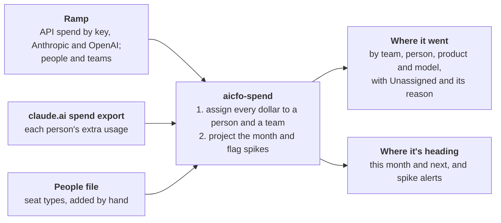

# aicfo-spend-analysis — design

**Status:** approved 2026-10-27. v1 is being built. The v0.3.0 scripts it replaces live in `legacy/` until each piece is replaced.

`aicfo-spend-analysis` is a small open-source tool, built on Ramp, that tells a company where its AI money went and where spending is heading. It reads the AI spend Ramp already collects through the Admin keys plugged into Ramp, so Ramp holds the keys and the tool never does. It runs without Claude. The `ai-spend-analysis` skill in the `ai-cfo-lab` plugin ([aircfo/claude-startup-finance](https://github.com/aircfo/claude-startup-finance)) becomes a thin layer that fetches the data, runs the tool and shows the results.

## What it does

The whole tool, in five sentences:

1. Each month it answers two questions about a company's AI spend: where did it go, and where is it heading?
2. It reads data the company already has: API spend for Anthropic and OpenAI and the people list from Ramp, plus each person's extra usage from the claude.ai spend export.
3. Every dollar goes to a person and a team; anything it can't place shows as Unassigned with the reason, so every dollar is accounted for.
4. It projects where this month will land and what next month will cost, and flags any day that spikes.
5. Claude fetches the data and shows the results; the math is an open-source Python tool anyone can run on their own files, and each new vendor is a small add-on.



Claude gathers the inputs and presents the answers; the open-source tool does the two steps in the middle.

**What a month looks like** (made-up numbers):

| Team | Seats | Extra usage | API | Total |
| --- | --- | --- | --- | --- |
| Engineering | $600 | $820 | $410 | $1,830 |
| Sales | $300 | $95 | $0 | $395 |
| Unassigned | $0 | $40 | $25 | $65 |
| **Total** | **$900** | **$955** | **$435** | **$2,290** |

- **Unassigned:** $40 of extra usage from someone not on the people list, and $25 from an API key with no team.
- **Forecast:** this month is on pace for $2,400, 5% above last month.
- **Alerts:** one spike, Engineering's API spend on the 14th at three times a normal day, drafted for someone to send.

Claude shows this as a dashboard; the tool itself writes the same numbers to plain files.

**Words used here**

- **Seat:** the flat monthly fee for one person's plan, such as Claude Team or ChatGPT Business.
- **Extra usage:** what a person spends beyond what their seat includes.
- **API spend:** pay-per-use charges when software calls a model with an API key.
- **Admin key:** an organization-level key that can read the usage bill. It can also manage the account, so Ramp keeps it, not the tool.
- **Team:** a group of people for reporting; Ramp calls it a department.

## Done when

v1 is done when these three things are true. The first two are commands that print a result; the third is checked on the pull request.

1. **September matches the dashboard.** `aicfo-spend report 2026-09` gives the same seats, extra usage and API totals for airCFO, the first install, as the v0.3.0 dashboard, within $1 a line, after those numbers have been reviewed by hand.
2. **The forecast is scored.** `aicfo-spend forecast --as-of 2026-08-31 --score 2026-09` prints how far the forecast was from September's actual total, in dollars and percent. No target is set, because one month of history is too thin to set one.
3. **A second vendor fits.** OpenAI's API spend and real ChatGPT seats show up beside Anthropic's, and the pull request that adds them changes only OpenAI's folder.

**Not in v1:** checking spend against invoices or card charges, companies not on Ramp (described under Inputs, built later), a FOCUS export, budgets, department-head sign-off, an accounting-system tie-out, splitting a shared key, currencies other than USD, a web UI, and sending anything (alerts and summaries are drafts).

## Inputs

Three inputs, matching the picture above. Claude fetches the first one through the Ramp connector.

| Input | What it gives | How it arrives |
| --- | --- | --- |
| Ramp | Daily API spend for Anthropic and OpenAI by model and key, with each key's owner and department, from the Admin keys plugged into Ramp; the people list (name, email, team, active) | Claude, through the Ramp connector |
| claude.ai spend export | Each person's extra usage | The existing browser script, or the export button. It covers only the last 90 days, so it's saved at least monthly |
| People file | Seat type for each person who holds a seat, plus anyone not in Ramp | Kept by hand or by Claude |

Settings (seat prices, seats bought, who sees person detail, alert thresholds) live in one small JSON file, `aicfo-spend.json`. It's JSON because Python 3.10 can't read TOML without an add-on package.

**Ramp holds the Admin keys, and the tool never touches one.** The tool doesn't call Claude or Ramp either: it reads files in a folder, which Claude fills through the Ramp connector or a person fills with exports from Ramp.

**Without Ramp** (described here, built later): the tool would read the Anthropic and OpenAI Admin APIs directly, with an Admin key kept on the company's own machine, and a short keys file would name each key's owner. The v0.3.0 Anthropic fetcher in `legacy/` is a starting point.

**Downloads are saved once and never edited.** Claude hands each download to `aicfo-spend save`, which files it in the folder for the month it covers as `<source>_<start>_<end>_saved-<time>` and makes it read-only. Ramp's per-key spend is saved one day per file. A rerun rebuilds every number from these files, so any number traces back to one. Each run re-pulls the last 7 days, because vendors revise them; when two files cover the same days from the same source, the one saved last counts and the older one stays for the record.

**One plain table.** Every input becomes rows of `spend.csv`: start date, end date, vendor, product (seats, extra usage or API), person, team, reason (for Unassigned rows), API key, model, amount in USD and source file. Daily data has the same start and end date; the claude.ai export covers its whole period. For API rows, the person is the key's owner. `aicfo-spend report <folder> <month>` writes the table and prints totals by team. Each company's files live in one folder, outside any git repo:

```text
<workspace>/
  aicfo-spend.json   settings: seat prices, seats bought, visibility, alert thresholds
  people.csv         seat type, plus anyone not in Ramp
  raw/<YYYY-MM>/     every download, saved once, never edited
  out/<YYYY-MM>/     spend.csv, forecast.json, dashboard data
```

## Who spent it

Two lookups place almost every dollar, and whatever they can't place shows as Unassigned with its reason.

1. **Person → team.** Seats and extra usage carry a person's email, and the Ramp people list gives their team. A seat costs the price for its type, from settings.
2. **API key → team.** A key's team is its Ramp department tag, or else its owner's team.

**Unassigned has three reasons**, each on its own line:

- **Not on the people list:** someone in the spend export who is in neither Ramp nor the people file.
- **Key with no team:** no department tag and no owner. The fix is made in Ramp, where the key lives.
- **Empty seat:** settings say how many seats were bought, and fewer people hold one. It's the signal to reclaim them.

**Nothing is split.** A shared key belongs to one team, so no row is divided and nothing needs rounding.

The same table gives both views, by team and by person. In the person view, API spend shows under each key's name with its owner beside it, because one key often serves a whole app.

## Forecast and alerts

The forecast is arithmetic anyone can redo by hand, and it stands in for a budget. Usage here means extra usage plus API; seats are a fixed monthly fee and are never averaged.

- **This month:** seats + usage so far + the last 14 days' average daily usage × days left.
- **Next month:** seats × price + each team's average monthly usage over the last 3 months, or over as many months as exist.
- **Change from last month:** by team and model, and by person where the person view is on.

**Two alerts**, always drafted, never sent:

- **Spike:** a team's daily usage at more than twice its 28-day median, and at least $25 above it.
- **Over pace:** the company's projection for this month is 25% or more above the forecast saved for it on the 1st.

The three alert numbers (2×, $25, 25%) are defaults, editable in settings.

**The backtest** (done criterion 2) replays the forecast as if it were Aug 31 and reports how far off September was. Per-person history before Aug 31 is one month, so that limit is shown beside the score rather than tuned away.

## Adding a vendor

Each vendor is one folder with one function that turns its saved files into rows of the plain table, plus a short guide and a test.

- **Anthropic:** its API spend comes through Ramp; its folder reads the claude.ai spend export and counts seats.
- **OpenAI:** its API spend already comes through Ramp too, so ChatGPT seats are its only new piece: who holds one comes from the people file, and the price from settings.
- **A vendor Ramp doesn't cover** adds a reader for its own export or API in the same folder.

`docs/adding-a-vendor.md` walks through the OpenAI build, and done criterion 3 checks that it changed only OpenAI's folder. The package:

```text
src/aicfo_spend/
  assign.py    who spent it
  forecast.py  forecast and alerts
  sources/     ramp.py, people.py
  vendors/     anthropic/, openai/
  cli.py       the aicfo-spend command
docs/          design.md, adding-a-vendor.md
legacy/        the v0.3.0 scripts, removed as they're replaced
```

## Privacy

Shared outputs show teams; whoever runs the tool can turn on the person view.

- **Teams by default.** Dashboard data and summaries roll people up to teams before they're written; person detail stays in the company's folder.
- **Small teams fold together.** A one-person team is a person, so shared outputs fold teams under 3 people into "Other (small teams)".
- **Company data never enters a repo.** Test files are made up.
- **A privacy scan runs before every commit**, checking the change against real names from the people list and the spend export.

## Install and the Claude skill

The tool uses only what comes with Python 3.10 or later, with no add-on packages, because Claude's cloud routines can't install add-ons but can run code from a repo they're given (tested 2026-10-26).

- **Cloud routines** attach the tool's repo, pinned to a release, and run it in place.
- **Cowork and the plugin:** the skill installs the pinned release from GitHub when it runs. The Cowork install test passed on 2026-10-27 in Cowork's cloud shell and its local shell (Python 3.10). Outside users need this repo to be public, so the cut-over comes after it is.
- **People and Macs:** `uv tool install git+https://github.com/aircfo/aicfo-spend-analysis@vX.Y.Z`.
- **Optional:** `[excel]` adds Excel workbooks.

**The skill's job** is to set up a company's folder, save the Ramp data and spend export into `raw/`, run the tool, and show the results and drafts. It records the tool version it was tested with, and its setup check fails if the installed version differs.

## Milestones

Five milestones, each ending at a gate.

| Milestone | What gets built | Gate |
| --- | --- | --- |
| M0 · Gates | Design approved, history moved, Cowork install test | Owner approval |
| M1 · September numbers | Readers for Ramp, the spend export and the people list; the two lookups; the monthly report | Done criterion 1 |
| M2 · Forecast | This month and next, change from last month, the two alerts, the Aug 31 backtest | Done criterion 2 |
| M3 · OpenAI | The adding-a-vendor guide and ChatGPT seats | Done criterion 3 |
| M4 · Cut-over | A tagged release; the skill installs it from GitHub and becomes the thin wrapper | A real month matches v0.3.0's numbers, then `legacy/` is deleted |

The test and release workflows need a code owner's approval.

**History.** This repo's history was moved from `aircfo/claude-startup-finance` on 2026-10-27, keeping every author and date. References like `aircfo/claude-startup-finance#11` point to the original pull requests.

## Decisions

| Decision | Choice |
| --- | --- |
| Record format | A plain table; a FOCUS export can be added later if asked (Appendix B) |
| Usage and cost data | Ramp by default and recommended: Ramp holds the Admin keys, and the tool is built on it |
| Companies without Ramp | Described under Inputs, built after v1 if someone asks |
| People list | Ramp's user list, plus seat type and anyone not in Ramp kept by hand |
| An API key's team | Its Ramp department tag, else its owner's team |
| Shared API keys | Each belongs to one team; nothing is split |
| Paid seats nobody uses | Unassigned, as the signal to reclaim them; seats bought come from settings |
| Who sees what | Team and person views; shared outputs show teams, and teams under 3 people fold into "Other" |
| Checking spend against bills | Not in v1; a person reviews the dashboard, and September must match v0.3.0's numbers |
| Budgets | None; the forecast is the yardstick |
| Department-head sign-off | Not in v1 |
| This month's projection | Seats + usage so far + the last 14 days' average daily usage × days left |
| Alert thresholds | Spike over twice the 28-day median and $25 above it; pace 25% over the forecast; all editable in settings |
| Names | Package `aicfo-spend-analysis`, import `aicfo_spend`, command `aicfo-spend` |
| Excel workbooks | An optional `[excel]` extra |
| How the plugin gets the tool | Installs the pinned release from GitHub when the skill runs |
| Settings file | JSON (`aicfo-spend.json`), readable by Python 3.10 with no add-ons |
| Marketplace listing | Added to the marketplace README in the pull request that makes this repo public |

## Risks

| Risk | Fallback |
| --- | --- |
| One month of per-person history before Aug 31 makes the backtest thin | Show the history length beside the score; don't tune to September |
| The claude.ai export endpoint is unofficial and can change | The export button always works by hand |
| Ramp changes or drops its AI spend data | Build the no-Ramp path described under Inputs |
| v1 doesn't check spend against bills | A person reviews each month in the dashboard; a bill check can be added later |

## Appendix A: lessons from other tools

We read three open-source cost trackers on 2026-10-26: OpenCost (core @ 47ef511, plugins @ dd5a24b), LiteLLM v1.108.0 and Langfuse v4.70.1. None of them assigns vendor bills to teams, so their value is in four lessons v1 keeps:

- **Usage is checked against the bill, never assumed to equal it.** OpenCost labels modeled cost as billed, and a maintainer has said "OpenCost has no reconciliation".
- **No row disappears silently.** OpenCost drops zero-cost rows, credits and unmatched costs, and in the request-path trackers a missing tool price can default to $0.
- **Vendor-reported dollars, not our own prices.** When Anthropic cut Sonnet 5.5 cache-read prices on 2026-10-07, LiteLLM and Langfuse both rewrote past costs at the new price, and LiteLLM's price file saw 281 commits in 30 days.
- **Each dollar is counted once.** In their tag reports, spend with several tags is counted once per tag, so departments can add up to more than the company total.

Two smaller habits: re-pulling the last 7 days, which OpenCost does well, and keeping money in exact decimals, where OpenCost uses 32-bit floats.

## Appendix B: FOCUS in brief

FOCUS (the FinOps Open Cost and Usage Specification) is an open standard for laying out a bill's data, so every vendor's charges land in the same columns with the same meanings, like a shared chart of accounts for vendor bills. The FinOps Foundation, part of the Linux Foundation, writes it. AWS exports it, and Azure's and Google's exports are in preview.

Version 1.4 is current (June 2026). Version 1.5, due for ratification on 2026-12-03, adds AI model billing: model, token direction and cache use. No AI vendor publishes FOCUS yet.

v1 uses a plain table instead. A FOCUS export would let the output plug into FinOps tools, but few startups run them. Adding one later means mapping the plain table's columns onto FOCUS's, and nothing in v1 stands in the way.

## Appendix C: API facts and sources

All checked 2026-10-26.

**Anthropic Admin API**

- **Usage report** (`/v1/organizations/usage_report/messages`):
  - Buckets: 1m, 1h or 1d.
  - Groups by API key, workspace, model, service tier, context window, region, speed, account.
  - Splits tokens into uncached input, 5-minute and 1-hour cache writes, cache reads and output, plus web-search requests.
  - Data lands within about 5 minutes. How far back you can query isn't documented. [usage and cost API](https://platform.claude.com/docs/en/manage-claude/usage-cost-api)
- **Cost report** (`/v1/organizations/cost_report`):
  - Daily only; groups by workspace and description only.
  - Amounts are decimal strings in cents.
  - Excludes Priority Tier. It is never stated to equal the invoice.
- **Claude Code analytics** (`/v1/organizations/usage_report/claude_code`): one row per user per day, with estimated cost. [Claude Code analytics API](https://platform.claude.com/docs/en/manage-claude/claude-code-analytics-api)
- **Team plan:** no usage API. The CSV spend export covers at most the last 90 days. [usage analytics for Team and Enterprise](https://support.claude.com/en/articles/12883420-view-usage-analytics-for-team-and-enterprise-plans)
- **Enterprise:** a separate Analytics API with per-user cost, history from 2026-01-01, and revisions up to about 7 days after month end. [analytics API](https://platform.claude.com/docs/en/manage-claude/analytics-api)
- **Invoices and prices:** no invoice API and no machine-readable price list. [pricing](https://platform.claude.com/docs/en/about-claude/pricing)
- **Org scope:**
  - An Admin key covers one Console org.
  - A Team plan is a separate org, and can link one Console org for pooled credits capped at $500 a month. [API credits for subscribers](https://platform.claude.com/docs/en/about-claude/api-credits-for-subscribers)

**OpenAI**

- **Usage API:** 1m / 1h / 1d buckets, grouped by project, user, API key and model.
- **Costs API:** daily, grouped by project, user, line item and key. Amounts are floats in dollars, and OpenAI says the totals reconcile to the invoice.
- **ChatGPT Business and Enterprise:** an analytics API and a 2026 Cost API whose dollar figures are estimates. There is no invoice API.

Source: [openai-openapi](https://github.com/openai/openai-openapi).

**FOCUS**

- **Releases:** 1.3 on 2025-12-08 and 1.4 on 2026-06-04. 1.5 is scheduled for ratification on 2026-12-03, with AI Model Billing in its draft. [FOCUS releases](https://github.com/FinOps-Open-Cost-and-Usage-Spec/FOCUS_Spec/releases) · [1.5 scope](https://focus.finops.org/focus-1-5-release-scope/)
- **1.4 contents:** 65 Cost and Usage columns, plus the Invoice Detail and Billing Period datasets, plus SaaS examples. [1.4 datasets](https://focus.finops.org/docs/specification/v1-4/datasets/) · [SaaS examples](https://focus.finops.org/docs/specification/v1-4/sections/appendix/saas-examples/)

**Other tools (Appendix A):** [opencost](https://github.com/opencost/opencost) · [opencost-plugins](https://github.com/opencost/opencost-plugins) · [litellm](https://github.com/BerriAI/litellm) · [langfuse](https://github.com/langfuse/langfuse).
